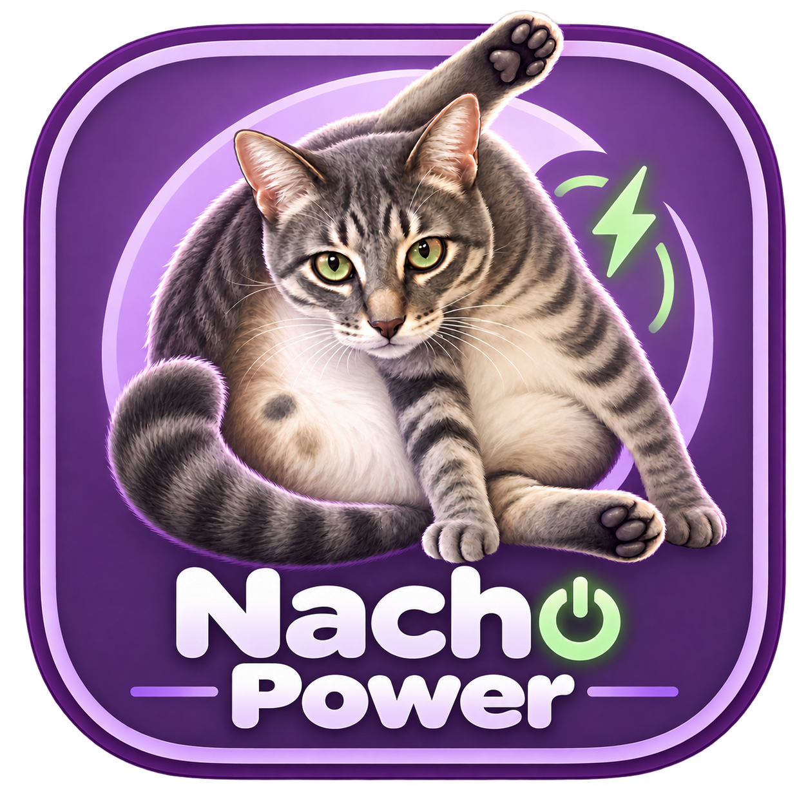

# Nacho Power



A Mac app that reminds you to reconnect your EcoFlow to AC power. It shows the station's battery percentage in the Dock and plays a transparent cat above your desktop when AC is disconnected. Clicks and keystrokes continue to reach the apps behind the cat.

The Dock icon and menu-bar battery indicator are **green when AC is connected** and **red when AC is disconnected**. It shows an unknown state when a reliable connection or AC reading is unavailable. A fully charged station can be green even while drawing 0 W.

The app includes left- and right-side cat videos and the logo. No Terminal, developer tools, PowerManager, or additional drivers are needed to run the installed app. Wireless setup has the account requirements described below; USB does not require an account.

## Install

Download the universal DMG from this repository's Releases page. Open it, drag **Nacho Power.app** into **Applications**, eject the disk image, and open the installed app. Click its Dock icon or menu-bar icon to open Settings, preview the cat, or quit.

Nacho Power was previously named **EcoFlow Cat**. When upgrading an older installation, quit EcoFlow Cat before opening Nacho Power. Your settings and saved EcoFlow sign-in are preserved. After installing Nacho Power, remove the old **EcoFlow Cat.app** from Applications to avoid launching both copies and competing for the station's connection.

The distributed app is ad-hoc signed and is not notarized by Apple. If macOS blocks it, follow [Apple's instructions for opening an app you trust](https://support.apple.com/en-us/102445).

Requires macOS 14 or newer. The app contains native Apple silicon and Intel binaries.

## Updates

Starting with **v1.3.0**, choose **Check for Updates** in Settings or the menu bar to check the latest published GitHub release. Enable **Check automatically for updates** in Settings to check immediately, then once a day while the app is open. The app also checks on launch when a daily check is due, and shows an update notice in the app and menu when a newer release is available. Starting with v1.3.3, automatic checking is off for fresh installs until selected; upgrading preserves your saved choice. You can turn it off at any time.

**Download installer** opens that release's DMG on GitHub. Installer filenames follow `Nacho-Power-VERSION-universal.dmg`. Open the downloaded disk image, quit Nacho Power, and replace the app in Applications. Updates require this installation step; the app does not install or restart itself automatically. The update check reads public release information from GitHub and does not send your EcoFlow credentials, station telemetry, or payment information.

**Users on v1.2.0 or earlier need to [download and install a newer release](https://github.com/untitledca/Nacho-Power/releases/latest) once** to get the update checker. Those older copies cannot receive an updater retroactively.

## Support Nacho Power

If you like the app, **Support Nacho Power** in Settings or the menu bar opens the same optional **$5 / $10 / $25 USD** QuickBooks checkouts used on the [Atom Film Lab Apps page](https://www.atomfilmlab.com/apps). Each is a one-time payment to Atom Film Lab Inc.; review the checkout before paying. Nacho Power remains free, and support does not unlock features.

## Connect and use

**Quit the official EcoFlow app before connecting Nacho Power.** It can hold the station's Bluetooth or Wi-Fi connection. Quit PowerManager as well when using USB.

Open **Connection settings**, choose a transport, enter any required details, and select **Save & connect**:

- **USB:** Connect the station's USB data connection to your Mac. No cloud account or internet access is needed.
- **Bluetooth:** Allow Nacho Power to use Bluetooth when macOS asks. It automatically finds your nearby supported DELTA and uses the account identity from a signed-in official EcoFlow app on this Mac when available. If account setup is needed, use **Sign in for Bluetooth** with your normal EcoFlow email and password. You do not need to find or type a numeric account code. This mode is a direct local connection and does not need internet after setup. An optional device serial number can select a specific station when several are nearby.
- **Wi-Fi (cloud):** Keep the station online through Wi-Fi. Enter its serial number, account region, and your EcoFlow developer access and secret keys. This mode uses EcoFlow's cloud API and requires internet access; it does not provide an offline connection to a station's Wi-Fi hotspot.
- **Automatic:** Tries USB first, then Bluetooth, then configured Wi-Fi cloud access. This is the default connection mode.

The app stores the discovered or signed-in Bluetooth account identity and cloud API keys in this Mac's Keychain. The optional sign-in helper sends your password directly to EcoFlow over HTTPS for that request and never saves it. Subsequent Bluetooth connections use the stored account ID. Settings show the battery, input power, AC state, and connection errors.

The default reminder setting is **Immediately**: a fresh, reliable AC-disconnected reading starts the intro once, followed by the loop repeating. **Bottom left** and **Top left** use `intro_left.mov` and `looping_left.mov`, where the cat enters from the left. **Bottom right** and **Top right** keep the original `intro.mov` and `loop.mov`. Reconnecting AC interrupts either video immediately and removes the cat with a short, approximately 0.18-second pop. It does not wait for charging watts or a separate outro movie. Existing saved battery-threshold preferences remain available; a threshold starts the cat only when the battery is strictly below that value.

The animation fills the selected display by default. Turn off full-screen fitting for a smaller corner overlay. Audio is muted. **Preview cat** plays the intro and two loops, then pops away; **End preview** dismisses it immediately.

Missing data never counts as an unplug event. A complete telemetry interruption starts a 30-second reminder grace period, then the cat hides. Bluetooth updates can contain only changed fields: a known explicit AC state stays valid while the same authenticated session continues delivering live telemetry. Disconnecting or a stalled stream clears that state before reconnecting. Explicit AC presence is authoritative even at 0 W. Starting with v1.3.2, firmware that omits that flag can use fresh AC-input voltage from an authenticated runtime-status request. Voltage-derived status expires after six seconds without a new voltage reading. Zero watts alone never means the AC cable is unplugged.

**A gray icon with a battery percentage means the app has battery data but no reliable AC status.** Check Settings for **AC status unavailable**. Wait briefly for the station's initial status, then use **Save & connect** with the official EcoFlow app closed. If the status stays unknown, report the station model and firmware, the connection source shown in Settings, and the displayed status. The app keeps AC unknown when neither an explicit AC-presence flag nor a fresh, usable AC-input voltage reading is available, even if the battery percentage is available. On newer DELTA 3 Plus firmware, install v1.3.2 or later to enable the voltage fallback.

## Device support and verification

USB monitoring has previously been verified on **DELTA 3 Plus**. It recognizes EcoFlow's USB UPS interface and discovers battery/AC feature fields from its HID descriptor. Other models and firmware are unverified; stations without this USB interface cannot use this USB mode.

The Bluetooth implementation targets **DELTA 3 and DELTA 3 Plus** serial prefixes **P231 / P351** with the supported encrypted BLE protocol. A live Bluetooth session on the project's **DELTA 3 Plus** has authenticated and returned battery percentage plus AC-connected status while drawing **0 W**. The same station has also completed physical AC unplug/reconnect checks. After a firmware update removed its legacy AC flag, v1.3.2 added authenticated runtime-voltage requests, validated against roughly 121 V connected and 1–2 V unplugged. Packet tests cover framing, authentication primitives, and telemetry decoding. These checks do not establish cloud access or compatibility with other stations, account regions, or firmware. Confirm a physical AC-unplug/reconnect cycle on your station before relying on its reminders.

Some firmware exposes dedicated AC watts; other firmware exposes combined input only. Settings label the latter **Input power** because solar/DC can contribute to it. An explicit AC-presence flag, or a fresh AC-input voltage reading when that flag is absent, controls the Dock and menu-bar colors and reminder independently of charging power.

The app reads telemetry, requests runtime status when needed, and performs wireless session authentication. It does not change power outputs, charging settings, battery limits, shutdown settings, or the station's Wi-Fi configuration. Native USB implementation details and prior hardware observations are documented in [Direct USB integration](docs/Direct-USB-integration.md). Third-party acknowledgments are included in [ThirdPartyNotices.txt](Resources/ThirdPartyNotices.txt).

## Build and test

The repository includes all runtime assets. To build from source, install Apple's Command Line Tools, then run:

```sh
Scripts/test.sh
Scripts/build.sh
Scripts/make-dmg.sh
```

The build compiles both architectures, bundles resources, and signs locally. The DMG includes drag-to-Applications installation and a SHA-256 checksum. Developer ID signing and Apple notarization require a suitable certificate and Apple Developer access.

Reminder tests cover thresholds, AC flicker, missing or stale readings, immediate explicit AC changes, and reconnection at zero watts. Native AppKit playback checks cover intro interruption, repeated loops, preview completion, pop timing, restarting during dismissal, and transparent click-through window behavior. Both supplied video pairs have passed a full intro → two loops → pop run. Side-switch tests cover both directions, preserving intro/loop progress, top/bottom moves, rapid changes, and interruption during dismissal.

USB hardware checks are optional: run `Scripts/test.sh --live` with a supported station connected and competing EcoFlow/PowerManager apps closed. Wireless credentials and a physical station are required for live wireless verification.

## Replace the animation

Export `intro.mov` / `loop.mov` for right positions, or `intro_left.mov` / `looping_left.mov` for left positions, as QuickTime ProRes 4444 with actual transparency. Keep the same canvas and frame rate, and match the intro's last frame to the loop's first frame. Then run:

```sh
Scripts/prepare-videos.sh /path/to/right-masters right
Scripts/prepare-videos.sh /path/to/left-masters left
Scripts/build.sh
Scripts/make-dmg.sh
```

Preparation checks decoded alpha pixels in the masters, makes smaller native HEVC files with alpha, then validates the converted files. It preserves the masters and rejects videos without usable transparency. Quit and reopen the app after rebuilding.

Both animation pairs use a **1920 × 1080 canvas at 24 fps**. The right pair has a **20-second intro** and **16.625-second loop**; the left pair has a **10-second intro** and **11.333-second loop**. The left pair adds approximately **5.8 MB** after conversion, with transparency preserved. Dismissal is an AppKit/Core Animation pop, so no outro asset is required.

The logo was generated from the supplied cat photograph using the built-in image generator. The [design prompt](docs/new-name-logo-prompt.txt) and [icon packager](tools/make-app-icon.swift) are included.
