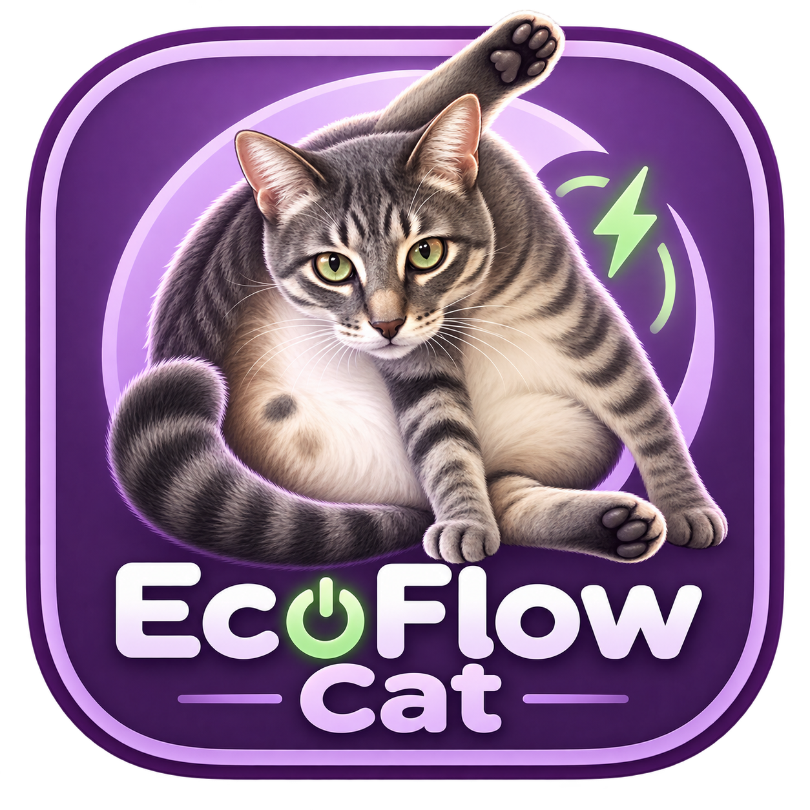

# EcoFlow Cat



A self-contained Mac app that reminds you to reconnect your EcoFlow to AC power. It reads the station directly over USB and plays a transparent cat animation above your desktop. Every click and keystroke continues to reach the apps behind the cat.

**No EcoFlow PowerManager, cloud account, Terminal, or developer tools are needed to run the app.** All three videos and the logo are included.

## Install

Download the universal DMG from this repository's Releases page. Open it, drag **EcoFlow Cat.app** into **Applications**, eject the disk image, and open the installed app. Its cat icon in the menu bar opens Settings and provides Preview and Quit.

This first release is ad-hoc signed and is not notarized by Apple. If macOS blocks the downloaded app, follow [Apple's instructions for opening an app you trust](https://support.apple.com/en-us/102445). Developer ID signing and notarization would make installation smoother for wider distribution.

Requires macOS 14 or newer. The app contains native Apple silicon and Intel binaries.

## Connect and use

Connect the EcoFlow's USB data connection to your Mac. Quit PowerManager if it is open so it does not compete for device access. Settings show the battery level, input watts and AC connection state.

Choose **Immediately** or a battery threshold. The default is strictly below 50%; exactly 50% does not start a reminder. When the station is on battery and the condition is met, the intro plays once and the middle repeats. Confirmed AC presence with positive input starts the outro, then the cat disappears.

The animation fills the selected display by default, placing entrances and exits at the screen edge. Choose the display in Settings. Turn off full-screen fitting if you prefer a smaller corner overlay. Audio is muted.

Two fresh readings confirm power changes. Missing data never counts as an unplug event. An active reminder has a 30-second grace period for lost telemetry, then hides without a charging outro. AC connected at a known 0 W holds the reminder until input becomes positive.

## Device support

Direct USB monitoring has been tested on **DELTA 3 Plus**. The reader recognizes EcoFlow's USB UPS interface and discovers battery/AC feature fields from its HID descriptor. Other compatible models are unverified; devices without this USB interface are unsupported.

The app reads battery percentage and AC presence through USB HID, and fresh input watts through a read-only USB serial telemetry query. Some firmware reports dedicated AC watts; DELTA 3 Plus firmware tested here reports total input only. In that case the reminder uses **AC present plus positive total input**, matching PowerManager's displayed Input condition. Solar/DC can contribute to that total; it is not presented as a separate AC meter.

The app does not change EcoFlow output, charging, battery, or shutdown settings. It uses only macOS system frameworks and has no bundled third-party drivers.

## Build and test

The repository includes all runtime assets. To build from source, install Apple's Command Line Tools, then run:

```sh
Scripts/test.sh
Scripts/build.sh
Scripts/make-dmg.sh
```

The build compiles both architectures, bundles resources, and signs locally. The DMG includes drag-to-Applications installation and a SHA-256 checksum. Developer signing and Apple notarization require a Developer ID certificate and appropriate Apple Developer access.

Automated tests cover reminder thresholds, AC flicker, stale and unknown readings, connected-but-idle AC, USB HID parsing, and serial packet validation. Native playback was also checked through intro, repeated middle, outro, and transparent click-through teardown. Live hardware checks are optional; use `Scripts/test.sh --live` with a supported station connected and PowerManager closed.

## Replace the animation

Export `intro.mov`, `middle.mov`, and `outro.mov` as QuickTime ProRes 4444 with actual transparency. Keep the same canvas and frame rate for all three. Then run:

```sh
Scripts/prepare-videos.sh /path/to/ProRes-masters
Scripts/build.sh
Scripts/make-dmg.sh
```

Preparation checks real alpha pixels and makes smaller native HEVC files with alpha. It preserves the masters. Quit and reopen the app after rebuilding.

The supplied animation uses a 1280 × 720 canvas at 24 fps: 10-second intro, 4.42-second middle, and 10-second outro. The native renderer scales it to the selected display.

The logo was generated from the supplied cat photograph using the built-in image generator. The [design prompt](docs/logo-prompt.txt) and [icon packager](tools/make-app-icon.swift) are included.
